# YiBangWeiGuangPublicWelfare
益暖微光公益服务平台
亮点：DeepSeek公益助手、善款信息追溯、志愿服务积分闭环、ECharts运营分析、活动状态自动流转；
角色：志愿者、捐赠者、管理员；

所有源码均本人开发，项目是前后端分离的，所有的项目都具备了完整的业务逻辑，不仅仅局限于基础的增删改查（CRUD）操作，系统亮点众多。

本文注重于计算机毕业设计选题指导，列出题目均有源码， 大家可以去【公众号】(毕业终点站)获取或者加我【qq】(2112698948)提意见(别忘记Star哟)。备注：git

声明：仅用于学习使用，请勿用于任何商业行为！

1.系统非商用，非开源，非无偿。

2.由本人开发，如需源码，请联系以下方式，qq:2112698948。

3.项目有很多，并未全部上传，如果未找到想要的，可直接咨询。

# 益暖微光公益服务平台

> B/S 前后端分离 · Web 前台 + 管理后台 · 管理员 / 捐赠者 / 志愿者三角色
>
> Spring Boot 3 + Vue 3 + Element Plus + MyBatis-Plus + MySQL + JWT + DeepSeek API + SSE + ECharts

一个把「捐钱」和「做志愿」放在同一套平台上的公益系统。捐赠者能看自己每一笔钱去了哪个孩子手里，志愿者能从报名、审核、签到一路拿到积分，再用积分去商城换东西；管理员在后面管项目、审报名、管帖子、发积分商品，用图表看筹款和参与情况。前台是暖橙色的卡片流，后台是标准的表格工作台，两套界面共用一套数据。

---

## 一、技术栈

| 层次 | 选型 |
| :--- | :--- |
| 架构 | B/S、MVC、前后端分离、Web 前台 + 管理后台、管理员 / 捐赠者 / 志愿者三角色 |
| 运行环境 | Windows |
| 开发工具 | IDEA、JDK 17、Maven、MySQL 8、Node.js |
| 后端 | Java、Spring Boot 3、Spring MVC、MyBatis-Plus、MySQL、JWT、定时任务、DeepSeek API |
| 前端 | Vue 3、Vite、Element Plus、Vue Router、Pinia、Axios、ECharts、AiEditor、SSE 流式响应 |

## 二、角色与功能范围

| 角色 | 主要使用范围 |
| :--- | :--- |
| 志愿者 | 注册登录、图形验证码、资料与密码管理；首页（分类入口、推荐项目、近期活动）；公益项目（分类筛选、搜索、项目详情、收藏、捐赠排行榜）；志愿活动（按方向与状态筛选、岗位要求与技能标签、报名、签到码签到）；公益论坛（发帖、评论、点赞、收藏）；AI 助手（SSE 流式问答、项目推荐、历史会话）；我的公益（活动记录、积分明细、兑换记录、我的收藏、我的帖子、我的评论） |
| 捐赠者 | 注册登录；公益首页与分类浏览、全站搜索、项目详情；创建捐赠订单、支付确认、取消与退款；我的捐赠记录；善款流向追溯（资金用途、受助对象、使用时间）；我的收藏、帖子、评论；AI 助手咨询 |
| 管理员 | 控制台；公益管理（项目管理、项目分类、项目进展、善款使用明细、捐赠记录、项目数据分析）；活动管理（志愿活动、活动分类、活动报名、报名签到、活动数据分析）；社区互动（论坛帖子、帖子评论、帖子点赞与收藏、收藏管理）；公益资讯；社区数据分析；积分商城（积分商品、积分兑换记录、积分记录）；系统（志愿者管理、捐赠者管理）；返回前台 |

## 三、功能亮点

- **DeepSeek 公益助手**：把用户的捐赠历史与在筹项目一起交给模型，生成的推荐理由能落到具体项目上；支持公益问答与 SSE 流式回复，历史会话可回看。截图里那句「我擅长绘画，有什么适合我的志愿活动吗」，回的是「推荐您参加爱心课堂支教活动，可以担任美术兴趣老师」——答的是岗位而不是泛泛的活动名。
- **善款信息追溯**：项目筹款进度、捐赠记录、资金用途、受助对象、项目进展五样东西串在一起看。捐赠者点进「善款流向」，看到的不是一句「已用于公益」，而是「缴纳学费 · 云南省昭通市巧家县 30 名初中生 · 2026-10-16」这样一条能对上的支出。
- **志愿服务积分流转**：报名 → 审核 → 签到 → 发积分 → 兑换商品 → 发货 → 确认收货，每一环都有各自的状态字段，一张活动记录就能看出这个人是被驳回了还是签到拿到了 12 分。
- **ECharts 运营分析**：项目维度看捐赠金额与笔数的近 7 天趋势、分类分布、状态分布、筹款完成率排行；活动维度看报名审核与签到；社区维度看帖子、话题与互动分布，日趋势与月趋势可切换。
- **活动状态自动流转**：后端定时任务按活动的开始、结束时间把状态刷成「进行中」「已结束」，不用人每天去点一遍关闭。

---

## 四、界面展示

> 说明：源文档首图为三角色共用登录页，未提供独立的系统总览图，故「登录入口」单独成节，首图不充当总览横幅。前台页面是整页长截图（0.88–1.86 比例），后台是 2.16:1 宽屏，两类一律全宽单图排布，避免文字被压糊。

### 4.1 登录入口

左半屏是一张孩子们伸手朝镜头笑的照片，压着一行「汇聚每一份 / 微小的光芒」，下面两行小字说「加入我们，与数百万志愿者一起，为需要帮助的人们带去希望与温暖。您的参与，让改变正在发生。」，底部两个数字：1.2M+ 注册志愿者、50K+ 公益项目。右侧登录卡是账号、密码、角色下拉、验证码（图里是 0789），下面一行「还没有账号？立即注册 / 忘记密码？」。

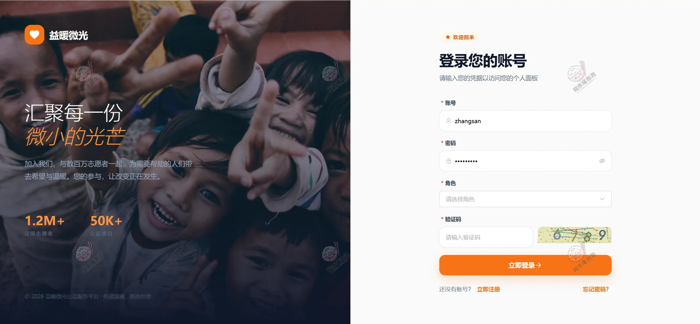

三个角色共用这一个入口，角色下拉决定进哪个身份：选志愿者进前台看活动和积分，选捐赠者进前台看捐赠与善款，选管理员进后台。截图里账号填的是 zhangsan、角色留空未选，正好是登录前的状态。

### 4.2 志愿者端

顶部一级导航七项：首页、公益项目、志愿活动、公益资讯、积分商城、公益论坛、AI 助手，右侧是搜索与当前用户（陈阳）。二级导航把个人事务摊开：我的公益、活动记录、积分明细、兑换记录、我的收藏、我的帖子、我的评论。

#### 首页

首屏是一张大图轮播，左侧文案「汇聚每一份善意 / 让微光成炬 让温暖抵达 / 从一份关心，到一次行动，和我们一起，让公益走进日常。」配一个「发现公益项目」按钮。图下面四个分类入口：爱心助学、敬老关怀、社区互助、生态环保，右侧一块「从今天，开始一件好事 / 去寻找身边的公益机会」+ 去参与。

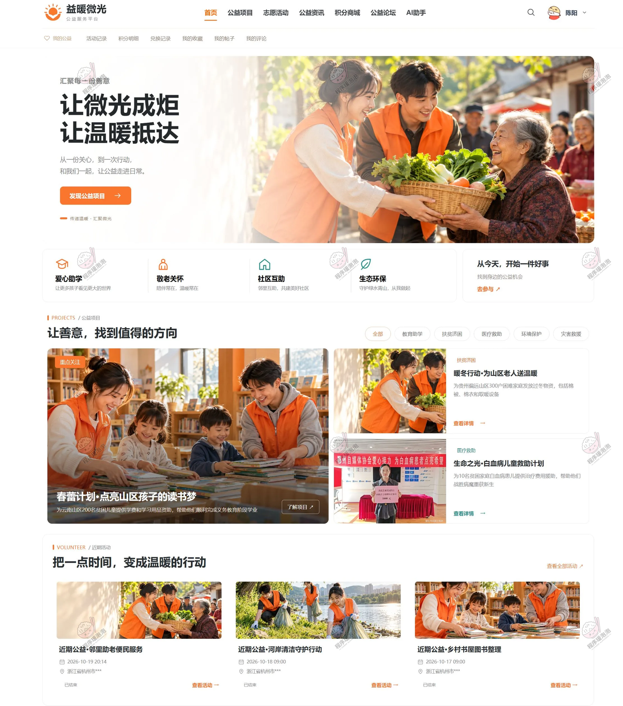

往下是「PROJECTS / 公益项目：让善意，找到值得的方向」，顶部一排分类标签（全部、教育助学、扶贫济困、医疗救助、环境保护、灾害救援）。三张项目卡分别是春蕾计划（左上角标「最近关注」）、暖冬行动、生命之光。再往下「VOLUNTEER / 近期活动：把一点时间，变成温暖的行动」，三张活动卡都标着「已结束」，时间分别是 10-19 20:14、10-18 09:00、10-17 09:00，地点都在浙江杭州市——这是定时任务把过期活动刷成结束状态之后的样子。

#### 公益项目

列表页顶部是一句「每一份善意，都能让美好发生。」，下面双行筛选：公益方向（全部 / 教育助学 / 扶贫济困 / 医疗救助 / 环境保护 / 灾害救援）与关键词搜索。共 4 个项目。

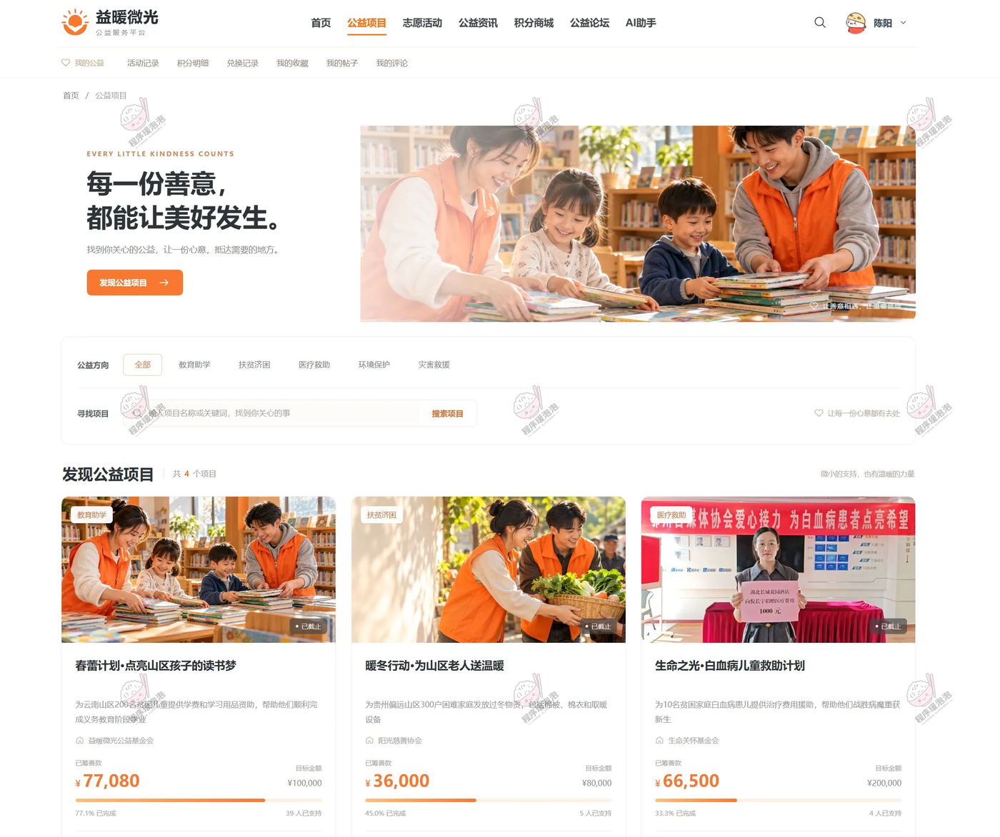

三张卡片把筹款情况说得很直白，每张都带进度条、已筹金额、目标金额、完成百分比与支持人数：

| 项目 | 分类 | 已筹 / 目标 | 完成度 | 支持人数 |
| :--- | :--- | :--- | :--- | :--- |
| 春蕾计划·点亮山区孩子的读书梦 | 教育助学 | ¥77,080 / ¥100,000 | 77.1% | 19 人 |
| 暖冬行动·为山区老人送温暖 | 扶贫济困 | ¥36,000 / ¥80,000 | 45.0% | 5 人 |
| 生命之光·白血病儿童救助计划 | 医疗救助 | ¥66,500 / ¥200,000 | 33.3% | 4 人 |

三个百分比都不是写死的：77080 ÷ 100000 = 77.08%，36000 ÷ 80000 = 45.0%，66500 ÷ 200000 = 33.25%，四舍五入后与页面显示一致。卡片还标了发起方——益路微光公益基金会、阳光慈善协会、生命关怀基金会，右上角统一挂「已截止」。

#### 志愿活动

顶部文案「把一点时间，留给温暖的事。」，下面三步说明把参与路径讲清楚：01 发现感兴趣的活动、02 了解要求并报名、03 一起行动，传递温暖。筛选两组：活动方向（全部 / 社区服务 / 环保公益 / 支教助学 / 敬老爱老 / 应急救援）与活动状态（全部状态 / 招募中 / 进行中 / 已结束 / 已取消）。共 12 场活动。

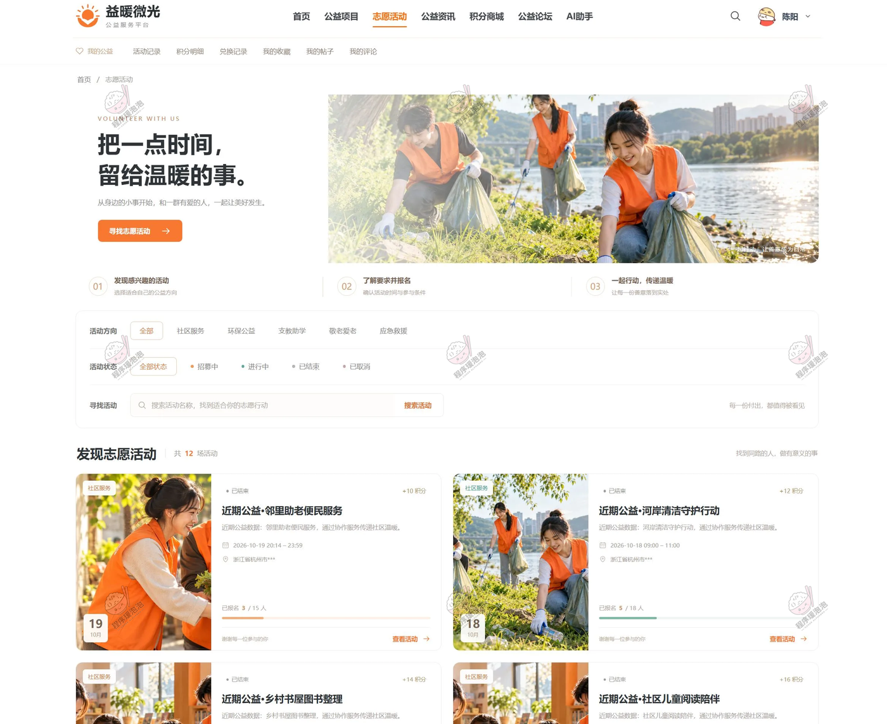

每张活动卡右上角标着这场能拿多少积分（+10、+12、+14、+16），左下角是已报名数与招募人数（3 / 15、5 / 18），右下角是关注人数（19、18）。「近期公益·邻里助老便民服务」时间是 2026-10-19 20:14 到 23:59、地点浙江杭州市，状态「已结束」，报名 3 / 15 人——这三个数在管理员端全部能对上。

#### 公益论坛

「把温暖的故事，讲给更多人听。」下面是「微光社区 共 15 篇分享」，搜索框加一排话题标签（全部故事、#志愿心得、#公益感悟、#爱心助学、#邻里互助、#公益讨论、#平台建议、#敬老关怀、#绿色公益）。

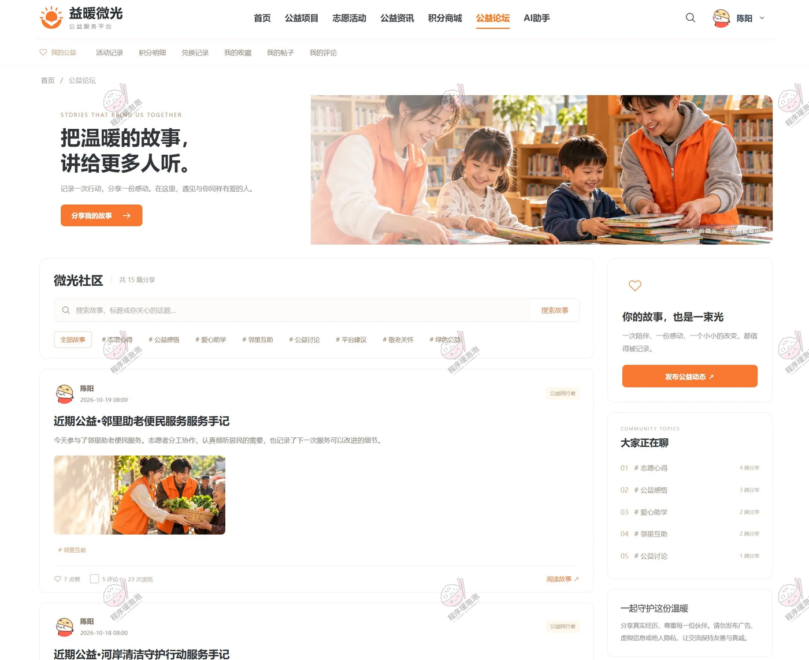

帖子流里第一条是陈阳在 2026-10-19 08:00 发的「近期公益·邻里助老便民服务服务手记」，正文写着「今天参与了邻里助老便民服务，志愿者分工协作，认真倾听居民的需要，也记录了下一次服务可以改进的细节。」，配两张现场照片，右下角身份标「公益同行者」。底下一行互动数据：7 点赞、5 评论、23 次浏览。右侧栏是「你的故事，也是一束光」+ 发布公益动态按钮，以及「大家正在聊」的话题榜：#志愿心得 4 篇、#公益感悟 3 篇、#爱心助学 2 篇、#邻里互助 2 篇、#公益讨论 1 篇。

#### AI 助手

「让善意，找到行动的方向」，下面是对话区。用户问「我擅长绘画，有什么适合我的志愿活动吗？」，助手回「推荐您参加爱心课堂支教活动，可以担任美术兴趣老师」。右上角一个「+ 新对话」，顶栏标着「微光相伴 · 公益同行」。

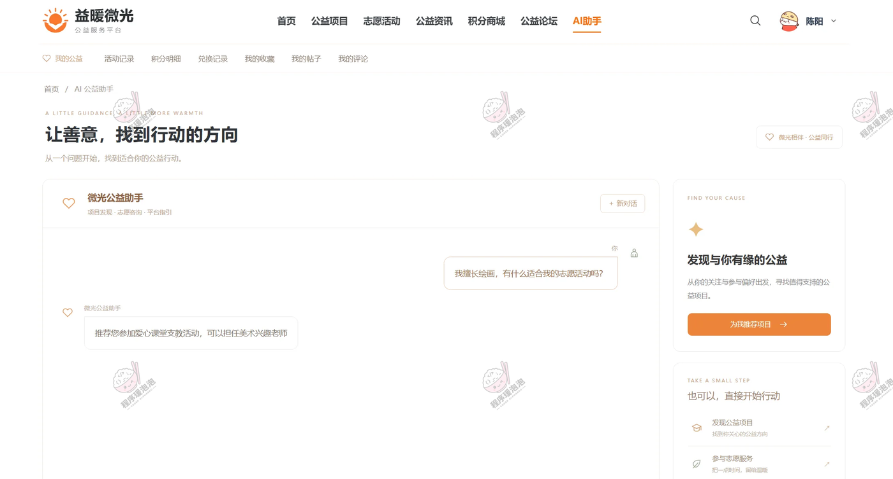

右侧两栏是入口而不是摆设：「发现与你有缘的公益」说明写着「从你的关注与参与偏好出发，寻找值得支持的公益项目」，配「为我推荐项目」按钮；下面「也可以，直接开始行动」给两个快捷入口——发现公益项目、参与志愿服务。推荐走的是用户偏好，不是随机推。

#### 活动记录

「活动记录 / 回顾参与的志愿行动，管理报名与签退。」下面是本人的三条记录：

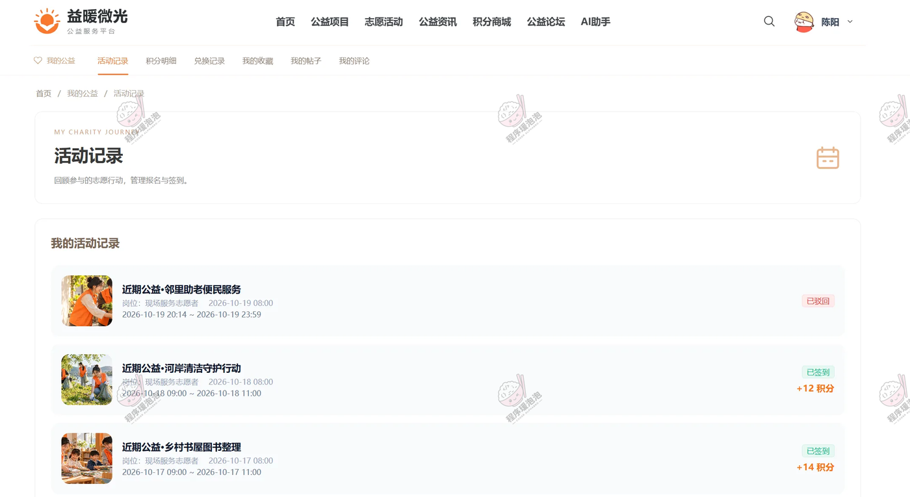

| 活动 | 岗位 | 时间 | 状态 |
| :--- | :--- | :--- | :--- |
| 近期公益·邻里助老便民服务 | 现场服务志愿者 | 2026-10-19 20:14 ~ 23:59 | 已驳回 |
| 近期公益·河岸清洁守护行动 | 现场服务志愿者 | 2026-10-18 09:00 ~ 11:00 | 已签到 **+12 积分** |
| 近期公益·乡村书屋图书整理 | 现场服务志愿者 | 2026-10-17 09:00 ~ 11:00 | 已签到 **+14 积分** |

三条记录把「报名 → 审核 → 签到 → 积分」这条链走完了：第一条卡在审核（已驳回），后两条审核通过、到场签到、积分到账。不同活动积分不同（12 和 14），是活动本身配置的分值，不是按人算的。

### 4.3 捐赠者端

捐赠者登录后一级导航少了「积分商城」，二级导航变成：捐赠记录、善款流向、我的收藏、我的帖子、我的评论。当前用户是李明。

#### 捐赠记录

「捐赠记录 / 记录每一份善意，让爱心有迹可循。」下面三条，全部投给春蕾计划：

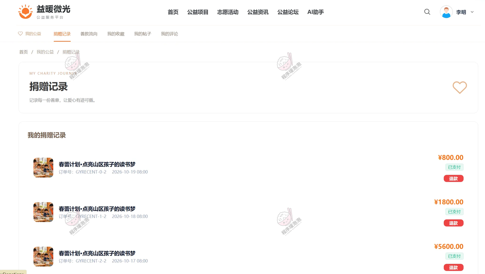

| 订单号 | 项目 | 时间 | 金额 | 状态 |
| :--- | :--- | :--- | :--- | :--- |
| GYRECENT-2-2 | 春蕾计划·点亮山区孩子的读书梦 | 2026-10-17 08:00 | ¥5600.00 | 已支付 |
| GYRECENT-1-2 | 春蕾计划·点亮山区孩子的读书梦 | 2026-10-18 08:00 | ¥1800.00 | 已支付 |
| GYRECENT-0-2 | 春蕾计划·点亮山区孩子的读书梦 | 2026-10-19 08:00 | ¥800.00 | 已支付 |

一单一行，金额右对齐用橙色标出来，状态是绿色的「已支付」，每条下面都挂着红色「退款」按钮——已支付仍可退，这是演示环境里把支付与退款都放开的做法。三笔加起来 8200 元，同一捐赠人可以分次投同一个项目，记录按单存不按项目合并。

#### 善款流向

这页是整套系统最能说明「追溯」二字的地方。「善款流向追溯 / 查看您捐赠项目的善款使用明细」下面两条记录，每条给四个字段：

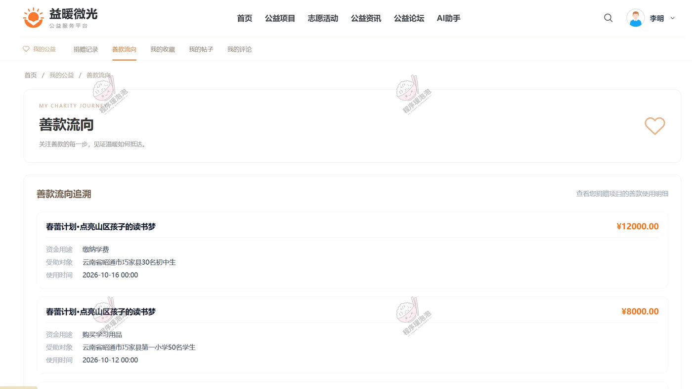

| 项目 | 金额 | 资金用途 | 受助对象 | 使用时间 |
| :--- | :--- | :--- | :--- | :--- |
| 春蕾计划·点亮山区孩子的读书梦 | ¥12000.00 | 缴纳学费 | 云南省昭通市巧家县 30 名初中生 | 2026-10-16 00:00 |
| 春蕾计划·点亮山区孩子的读书梦 | ¥8000.00 | 购买学习用品 | 云南省昭通市巧家县第一小学 50 名学生 | 2026-10-12 00:00 |

钱没有笼统地写「已用于助学」，而是分开说：一万二交了 30 个初中生的学费，八千买了 50 个小学生的学习用品。受助对象精确到县、精确到班级人数，捐赠者能自己判断这笔钱花得对不对。两笔合计 20000 元，与管理员端「善款使用明细」是同一批数据。

### 4.4 管理员端

左侧菜单：控制台、公益管理（项目管理 / 公益项目 / 项目分类 / 项目进展 / 善款使用明细 / 捐赠记录 / 项目数据分析）、活动管理（志愿活动 / 活动分类 / 活动报名 / 报名签到 / 活动数据分析）、社区互动（论坛管理 / 论坛帖子 / 帖子评论 / 帖子点赞 / 收藏管理）、公益资讯、社区数据分析、积分商城（积分商品 / 积分兑换记录 / 积分记录）、系统（志愿者管理 / 捐赠者管理），底部是返回前台与退出登录。

#### 公益项目管理

筛选三项：关键词、项目分类、项目状态，右上角「+ 新增项目」。列表六行，字段是项目名称、分类名称、项目简介、目标金额、已筹金额、捐赠人次、截止日期、项目图片、发起方，操作列按项目状态给「已完成 / 关闭 / 编辑 / 删除」或「开启 / 编辑 / 删除」。

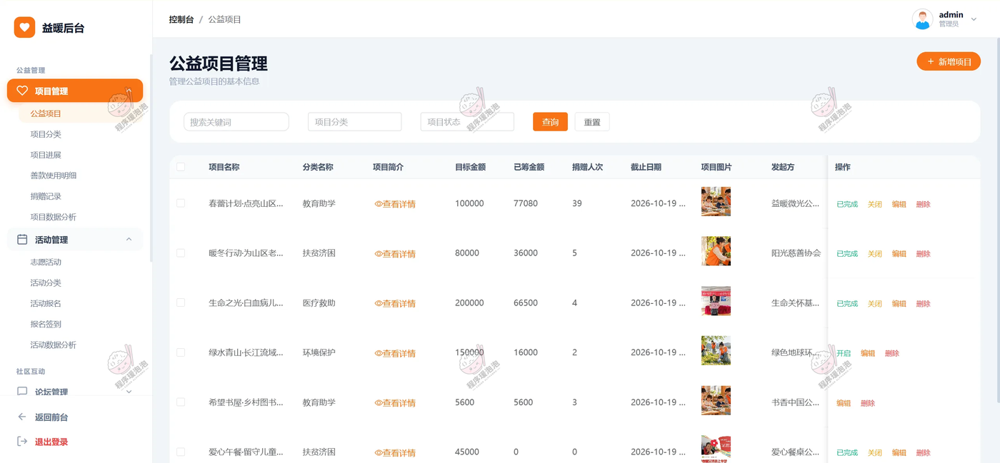

| 项目 | 分类 | 目标金额 | 已筹金额 | 捐赠人次 | 发起方 |
| :--- | :--- | :--- | :--- | :--- | :--- |
| 春蕾计划·点亮山区… | 教育助学 | 100000 | 77080 | 39 | 益暖微光公益基金会 |
| 暖冬行动·为山区老… | 扶贫济困 | 80000 | 36000 | 5 | 阳光慈善协会 |
| 生命之光·白血病儿… | 医疗救助 | 200000 | 66500 | 4 | 生命关怀基金会 |
| 绿水青山·长江流域… | 环境保护 | 150000 | 16000 | 2 | 绿色地球环保… |
| 希望书屋·乡村图书… | 教育助学 | 5600 | 5600 | 3 | 书籍中国公益… |
| 爱心午餐·留守儿童… | 扶贫济困 | 45000 | 0 | 0 | 爱心餐桌公益… |

前台那三个项目的已筹金额和这里一模一样（77080、36000、66500），说明前台卡片读的就是这张表的字段。前台第 5 个项目「希望书屋」已经筹满（5600 / 5600），后台操作列只剩「编辑 / 删除」，没有再给关闭与开启——满了的项目不再需要人手动结算。

#### 项目数据分析

六张指标卡：项目总数 6、筹款总额 ¥201180.00、捐赠笔数 53、捐赠人数 6、善款已用 ¥110000.00、捐赠来源 6。

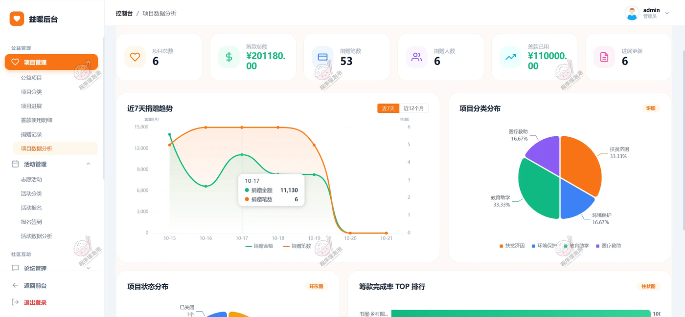

筹款总额 201180 是把上面六个项目的已筹金额加起来得到的：77080 + 36000 + 66500 + 16000 + 5600 + 0 = 201180，一分不差。

下面四块图：

- **近 7 天捐赠趋势**（双轴折线，可切近 7 天 / 近 12 个月）：左轴是捐赠金额、右轴是捐赠笔数，横轴 10-15 到 10-21。悬停 10-17 那天给出的提示是「捐赠金额 11,130、捐赠笔数 6」，10-19 之后两条线一起归零——活动截止、项目结项，筹款窗口关掉了。
- **项目分类分布**（饼图）：扶贫济困 33.33%、教育助学 33.33%、医疗救助 16.67%、环境保护 16.67%。六个项目按分类拆：教育 2 个、扶贫 2 个、医疗 1 个、环保 1 个，2÷6 和 1÷6 正好是这四个百分比。
- **项目状态分布**（环形图）：按进行中 / 已关闭等状态拆分，图里已关闭 1 个。
- **筹款完成率 TOP 排行**（柱状图）：第一名是「希望书屋·乡村图书…」100%，与项目列表里 5600 / 5600 吻合。

#### 志愿活动管理

筛选四项：关键词、活动分类、活动状态、开始时间起止。列表字段是活动名称、分类名称、活动简介、开始时间、结束时间、活动地点、招募人数、已报名，操作列四个按钮：编辑、关闭、报名签到、删除。

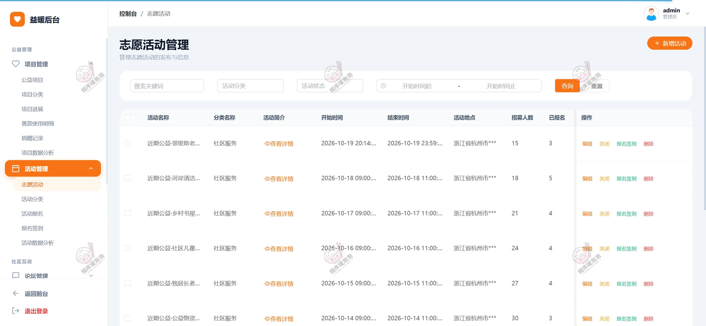

| 活动 | 开始时间 | 招募人数 | 已报名 |
| :--- | :--- | :--- | :--- |
| 近期公益·邻里助老便民服务 | 2026-10-19 20:14 | 15 | 3 |
| 近期公益·河岸清洁守护行动 | 2026-10-18 09:00 | 18 | 5 |
| 近期公益·乡村书屋图书整理 | 2026-10-17 09:00 | 21 | 4 |
| 近期公益·社区儿童阅读陪伴 | 2026-10-16 09:00 | 24 | 4 |
| 近期公益·独居长者… | 2026-10-15 09:00 | 27 | 4 |
| 近期公益·公益物资… | 2026-10-14 09:00 | 30 | 3 |

前两行拿去和前台对照：邻里助老前台卡片写「已报名 3 / 15 人」，河岸清洁写「已报名 5 / 18 人」，与后台的招募人数、已报名数一对一吻合。招募人数按时间递减排下来是 15、18、21、24、27、30，每场加 3 人——演示数据是按时序铺的。

#### 报名签到管理

「查看已通过审核的报名记录并快速签到」，筛选只有活动与签到状态两项。

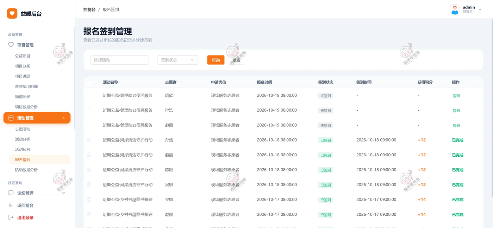

列表字段：活动名称、志愿者、申请岗位、报名时间、签到状态、签到时间、获得积分、操作。报名时间统一是活动前一天的 08:00，签到时间统一是活动当天 09:00:00，岗位都是「现场服务志愿者」。

- 邻里助老便民服务：周欣、孙浩、赵丽三人 2026-10-19 08:00 报名，签到状态「未签到」，签到时间与积分为空，操作列是可点的「签到」。
- 河岸清洁守护行动：孙浩、赵丽、陈阳、吴敏四人 2026-10-18 08:00 报名，已签到、签到时间 2026-10-18 09:00:00、获得积分 +12，操作列已成「已完成」。
- 乡村书屋图书整理：吴敏、赵丽两人 2026-10-17 08:00 报名，已签到 2026-10-17 09:00:00、+14 积分。

> 这一页和志愿者端能对上：陈阳的活动记录里「河岸清洁守护行动 +12 积分、已签到」，后台签到表里陈阳这一行同样是 +12、已签到、2026-10-18 09:00:00。河岸清洁后台显示已报名 5 人，签到表只出现 4 人——因为这一页只列「已通过审核」的报名，剩下那一位还卡在审核环节。

#### 论坛帖子管理

筛选三项：关键词、用户、帖子状态。列表字段很长：账号、帖子标题、帖子内容、帖子图片、话题标签、帖子状态、点赞数、评论数、收藏数、浏览量，操作是评论列表与删除。

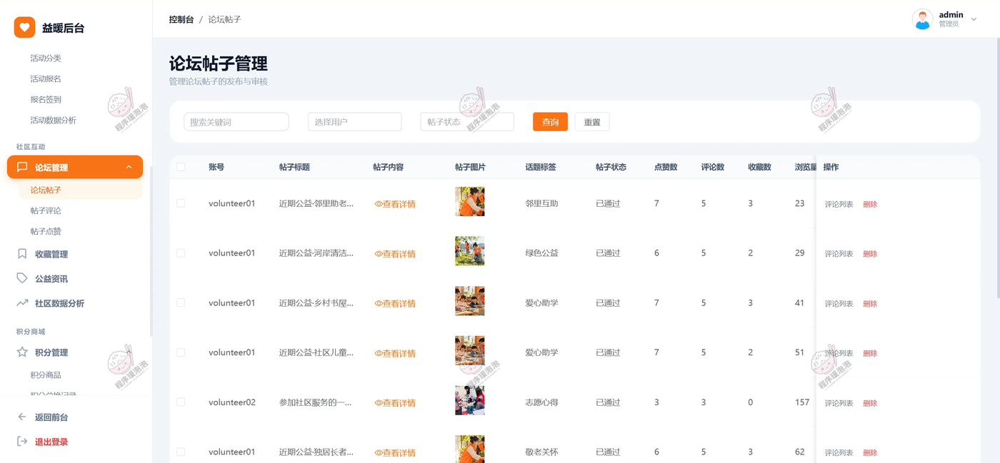

| 账号 | 标题 | 话题标签 | 状态 | 赞 | 评 | 藏 | 浏览 |
| :--- | :--- | :--- | :--- | :--- | :--- | :--- | :--- |
| volunteer01 | 近期公益·邻里助老… | 邻里互助 | 已通过 | 7 | 5 | 3 | 23 |
| volunteer01 | 近期公益·河岸清洁… | 绿色公益 | 已通过 | 6 | 5 | 2 | 29 |
| volunteer01 | 近期公益·乡村书屋… | 爱心助学 | 已通过 | 7 | 5 | 3 | 41 |
| volunteer01 | 近期公益·社区儿童… | 爱心助学 | 已通过 | 7 | 5 | 2 | 51 |
| volunteer02 | 参加社区服务的… | 志愿心得 | 已通过 | 3 | 3 | 0 | 157 |
| volunteer01 | 近期公益·独居长… | 敬老关怀 | 已通过 | 6 | 5 | 3 | 62 |

第一行拿去和前台论坛比：前台陈阳那条「邻里助老便民服务服务手记」显示 7 点赞、5 评论、23 次浏览，后台 volunteer01 这一行完全一致——三个计数不是前端自己加的，是从这张表读的。话题标签也一栏对一栏：#邻里互助、#绿色公益、#爱心助学、#敬老关怀，正好覆盖前台「大家正在聊」里的几个。

#### 积分兑换记录

筛选四项：关键词、用户、商品、兑换状态，共 3 条，含分页控件。

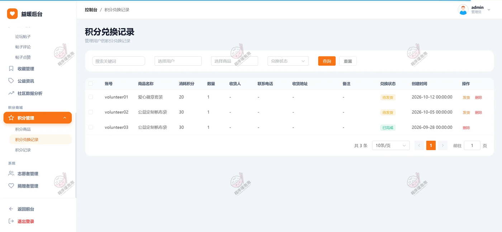

| 账号 | 商品 | 消耗积分 | 数量 | 创建时间 | 状态 | 操作 |
| :--- | :--- | :--- | :--- | :--- | :--- | :--- |
| volunteer01 | 爱心徽章套装 | 20 | 1 | 2026-10-12 | 待发货 | 发货 / 删除 |
| volunteer02 | 公益定制帆布袋 | 30 | 1 | 2026-10-05 | 待发货 | 发货 / 删除 |
| volunteer03 | 公益定制帆布袋 | 30 | 1 | 2026-09-28 | 已完成 | 删除 |

三条记录正好展示了兑换的两种状态：待发货还能点「发货」，已完成只剩「删除」。收件人、联系电话、收货地址三列在这三条里都是空的（显示为「-」），说明演示数据只录了兑换动作没录收货信息——发货按钮点了之后走的是线下沟通。至此积分这条线走完：签到拿 12 分、14 分，兑换时扣 20 分、30 分，扣完变成待发货，发货后转已完成。

---

## 五、几个实现要点

**筹款进度与完成率**。`已筹金额 / 目标金额` 是最直接的口径，前台把它算成百分比写进进度条，后台在分析页用同一批数据做分类分布与完成率排行。所以改一笔捐赠记录，前台卡片、后台列表、分析饼图三处会一起变——这也是本文能拿前后台数字互相验证的原因。

**善款追溯的四个锚点**。一条善款使用明细至少要有：资金用途（学费 / 学习用品）、受助对象（县 + 学校 + 人数）、使用时间、所属项目。四个字段齐了，捐赠者才能从「我捐了 5600」追到「这 12000 里有一部分买了我捐的书」这种颗粒度。缺任何一个，「追溯」就退化成一句口号。

**积分发放与兑换的两段扣减**。签到那一刻按活动配置的分值（12 或 14）发放，写进积分明细；兑换商品时按商品设定的积分（20 或 30）扣减并生成兑换记录，记录带待发货 / 已完成状态。兑换记录与积分明细是两条独立的流水，同一个用户既有「+12」也有「-20」，余额由流水累加得出，而不是在用户表上放一个可被覆盖的字段。

**审核这一环不能省**。报名记录有申请岗位、报名时间、审核结果三个字段，只有审核通过的才会出现在签到表里。活动卡片上显示「已报名 5」是报名数（含待审），签到表只列 4 人是通过数——两个数字本来就该不一样，硬把它们做成一样反而说明审核没起作用。

**活动状态交给定时任务**。活动有开始时间与结束时间，状态（招募中 / 进行中 / 已结束 / 已取消）由定时任务按当前时间刷新，人只负责「取消」这种例外操作。前台那些标着「已结束」的活动卡，时间都停在 10-19 之前，不需要谁手动点关闭。

## 六、说明

- 文档展示 15 张截图，需要了解更多，请联系我。
